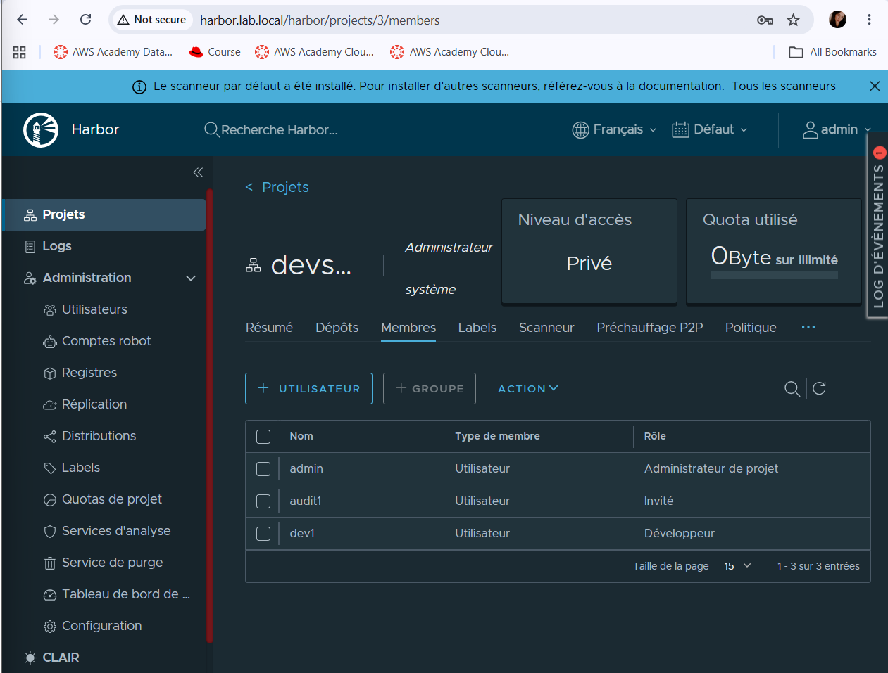
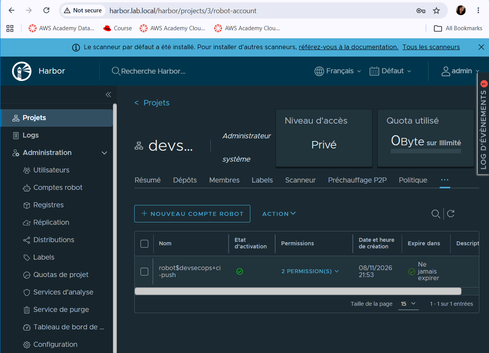
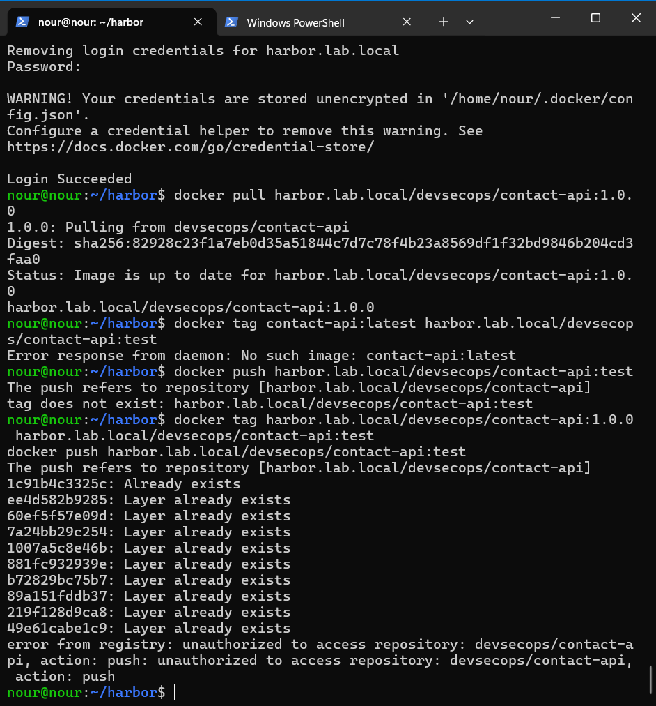
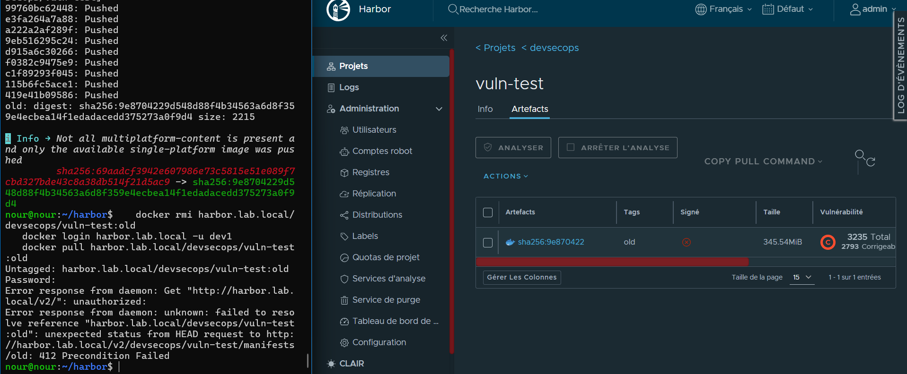
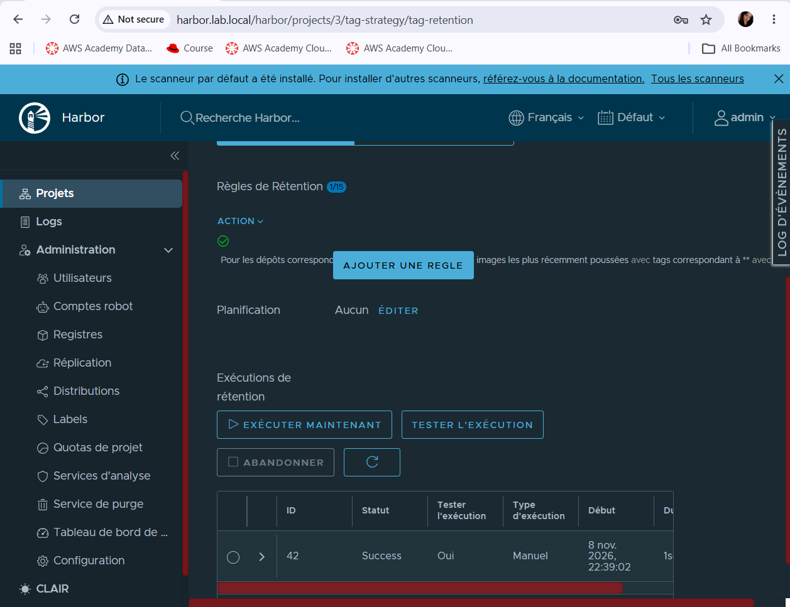
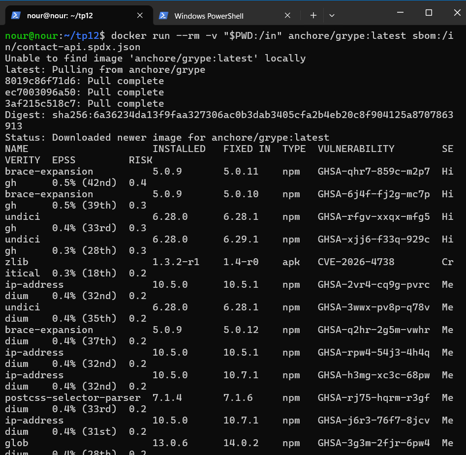
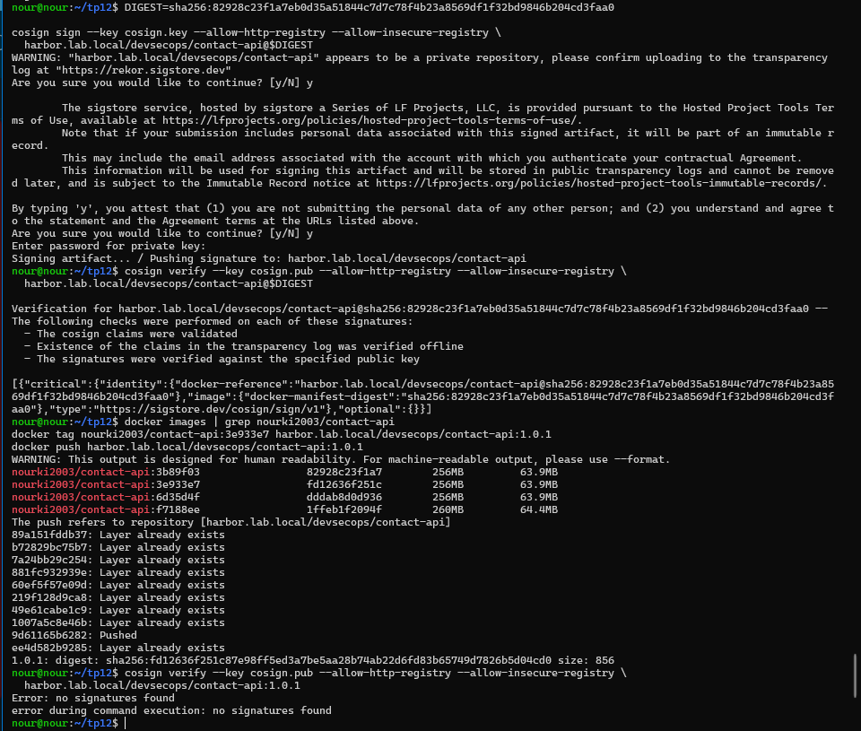
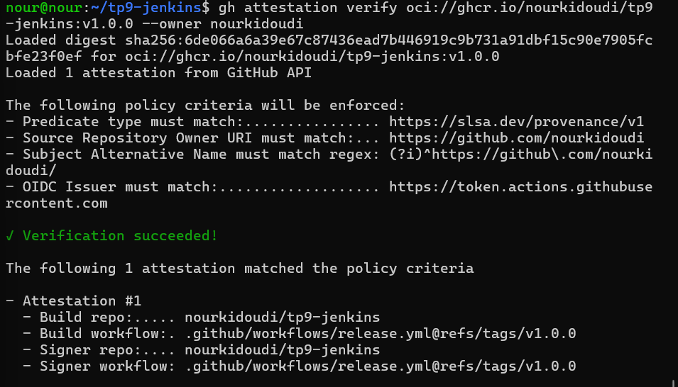
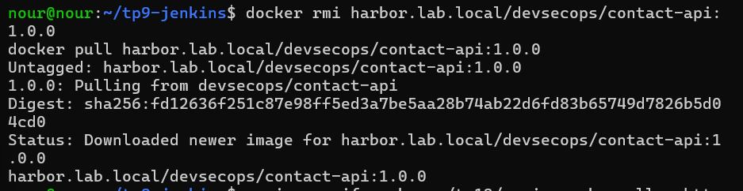
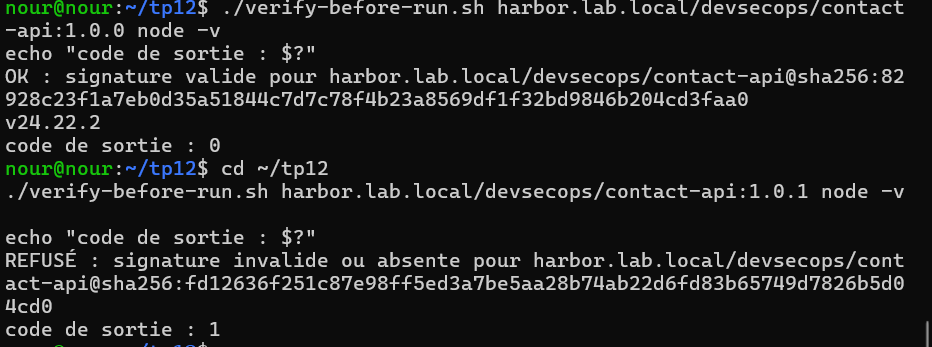

# TP12 : Software Supply Chain (Harbor, SBOM, Cosign, provenance, SLSA)

**Master DevOps & Cloud Computing, ISET Tozeur**
**Étudiante :** Nour Kidoudi

Ce TP met en place les briques qui permettent de savoir ce que contient une image (SBOM), de prouver qui l'a construite et comment (signature, provenance) et de refuser ce qui n'est pas prouvé, autour d'un registre privé Harbor.

```
Build  →  SBOM  →  Scan  →  Push (Harbor)  →  Signature  →  Attestation  →  Vérification avant déploiement
```

> Règle de base du TP : on signe et on vérifie toujours un **digest** (`sha256:...`), jamais un tag modifiable.

---

## 1. Environnement

| Élément | Valeur |
|---|---|
| Machine | Une seule VM Ubuntu (Harbor et client Docker sur la même machine) |
| Harbor | v2.10.0, installeur en ligne, `--with-trivy`, HTTP (lab isolé) |
| Nom du registre | `harbor.lab.local` (résolu via `/etc/hosts`) |
| Image utilisée | `contact-api` des TP précédents (`nourki2003/contact-api:3b89f03`) |
| Digest de l'image signée | `sha256:82928c23f1a7eb0d35a51844c7d7c78f4b23a8569df1f32bd9846b204cd3faa0` |
| Dépôt GitHub du workflow | `nourkidoudi/tp9-jenkins` (le code de l'API `contact-api`) |

### Problèmes rencontrés

- **`harbor.yml` invalide** : des commandes avaient été collées dans le fichier YAML (`could not find expected ':'`). J'ai repris le modèle `harbor.yml.tmpl` et modifié uniquement `hostname`, le bloc `https` (mis en commentaire) et le mot de passe admin, puis validé le fichier avec Python avant `install.sh`.
- **`404 page not found` sur `harbor.lab.local`** : k3s (Traefik) tournait sur la même VM et interceptait le port 80 avant Docker. J'ai arrêté et désactivé k3s (`systemctl stop/disable k3s` et `k3s-killall.sh`), puis relancé Docker et Harbor.
- **Harbor inaccessible depuis le navigateur Windows** (`DNS_PROBE_FINISHED_NXDOMAIN`) : ajout de `192.168.237.130 harbor.lab.local` dans le fichier `hosts` de Windows.
- **`412 Precondition Failed` au push** : la protection « Empêcher les images vulnérables de s'exécuter » refusait une image dont le scan était en erreur (`PROJECTPOLICYVIOLATION`).
- **`gh attestation` introuvable** : la version de `gh` des dépôts Ubuntu était trop ancienne. Installation de la version officielle (2.103.3).

---

## 2. Partie 1 : Installation de Harbor

```bash
cp harbor.yml.tmpl harbor.yml        # hostname: harbor.lab.local, bloc https commenté
sudo ./install.sh --with-trivy
docker compose ps                    # tous les conteneurs healthy
```

Le registre HTTP est autorisé côté Docker dans `/etc/docker/daemon.json` :

```json
{ "insecure-registries": ["harbor.lab.local"] }
```

> En production, un registre est toujours servi en HTTPS. Le mode HTTP n'est acceptable que dans un lab isolé.

---

## 3. Partie 2 : Projets, RBAC, scan et rétention

### Projet, membres et robot account

- Projet privé `devsecops`
- `dev1` : rôle **Developer** (tirer et pousser)
- `audit1` : rôle **Guest** (tirer uniquement)
- Robot account `ci-push` limité au projet `devsecops`, permissions **push + pull** uniquement





Image poussée avec le robot account :

```bash
docker login harbor.lab.local -u 'robot$devsecops+ci-push'
docker tag nourki2003/contact-api:3b89f03 harbor.lab.local/devsecops/contact-api:1.0.0
docker push harbor.lab.local/devsecops/contact-api:1.0.0
```

### Vérification du RBAC

`audit1` peut tirer l'image mais le push est refusé (`denied: requested access to the resource is denied`) : le rôle Guest est en lecture seule.



### Scan Trivy et blocage des images vulnérables

Options activées sur le projet : **Automatically scan images on push** et **Prevent vulnerable images from running** (gravité Critical).

Rapport Trivy de `contact-api:1.0.0` : 20 vulnérabilités (6 Haut, 13 Moyen, 1 Bas, aucune Critique). Les paquets concernés (`undici`, `brace-expansion`, `ip-address`, `glob`, `minimatch`, `zlib`) viennent de l'image de base et de npm, pas du code de l'API. Cette image n'est donc pas bloquée. Une image ancienne contenant des vulnérabilités critiques est, elle, refusée au `docker pull`.



### Rétention et immutabilité

- Règle de rétention : dépôt `retention-demo`, conserver les **5 derniers artefacts poussés**. Après 7 tags poussés (`t1` à `t7`), un **dry run** montre que `t1` et `t2` seraient supprimés. Le test se fait sur un dépôt séparé pour ne pas toucher à `contact-api`.
- Règle d'immutabilité : tags `v*` (un tag immuable ne peut ni être écrasé ni supprimé).



---

## 4. Partie 3 : SBOM avec Syft, scan avec Grype

```bash
docker run --rm -v /var/run/docker.sock:/var/run/docker.sock -v "$PWD:/out" anchore/syft:latest \
  harbor.lab.local/devsecops/contact-api:1.0.0 \
  -o spdx-json=/out/contact-api.spdx.json -o cyclonedx-json=/out/contact-api.cdx.json

docker run --rm -v "$PWD:/in" anchore/grype:latest sbom:/in/contact-api.spdx.json
```

| Question | Réponse |
|---|---|
| Nombre de paquets dans le SBOM | **250** |
| Version d'express | **5.3.0** |
| Version d'openssl | **3.5.9-r0** (paquets Alpine `libssl3` et `libcrypto3`, qui fournissent OpenSSL ; `ssl_client` 1.37.0-r31 est un composant BusyBox distinct) |

Grype analyse le **SBOM** et non l'image : conserver le SBOM de chaque release permet de répondre en quelques secondes à « suis-je concerné par la nouvelle CVE X ? » sans reconstruire ni retélécharger les images.



Les fichiers sont dans le dossier [`sbom/`](sbom/).

---

## 5. Partie 4 : Signer et vérifier avec Cosign (paire de clés)

```bash
cosign generate-key-pair            # cosign.key (privée, chiffrée) + cosign.pub

DIGEST=sha256:82928c23f1a7eb0d35a51844c7d7c78f4b23a8569df1f32bd9846b204cd3faa0
cosign sign --key cosign.key --allow-http-registry --allow-insecure-registry \
  harbor.lab.local/devsecops/contact-api@$DIGEST

cosign verify --key cosign.pub --allow-http-registry --allow-insecure-registry \
  harbor.lab.local/devsecops/contact-api@$DIGEST
```

- `1.0.0` (signée) : la vérification réussit.
- `1.0.1` (digest `sha256:fd12636f...`, jamais signée) : `Error: no signatures found`.



### Attestation du SBOM

```bash
cosign attest --yes --key cosign.key --type spdxjson --predicate contact-api.spdx.json \
  --allow-http-registry --allow-insecure-registry harbor.lab.local/devsecops/contact-api@$DIGEST
cosign verify-attestation --key cosign.pub --type spdxjson \
  --allow-http-registry --allow-insecure-registry harbor.lab.local/devsecops/contact-api@$DIGEST
```

La vérification de `1.0.0` remonte deux éléments : la signature (`cosign/sign/v1`) et l'attestation SBOM (`spdx.dev/Document`).

> `cosign.key` n'est **jamais** versionnée : elle est dans le `.gitignore`. Seule `cosign.pub` est publiée.

---

## 6. Partie 5 : Keyless et provenance dans GitHub Actions

Harbor n'étant pas joignable depuis GitHub, cette partie publie dans **GHCR**. Le workflow [`release.yml`](release.yml) est déclenché par un tag `v*.*.*` et enchaîne : build et push, SBOM (`anchore/sbom-action`), signature Cosign **keyless**, attestation de provenance (`actions/attest-build-provenance`) et SBOM attaché à la release.

En mode keyless, aucune clé n'est stockée : GitHub fournit un jeton OIDC qui prouve l'identité du workflow, Fulcio émet un certificat éphémère et la signature est inscrite dans le journal public de transparence Rekor.

```bash
git tag v1.0.0 && git push origin v1.0.0

cosign verify ghcr.io/nourkidoudi/tp9-jenkins:v1.0.0 \
  --certificate-identity-regexp 'https://github.com/nourkidoudi/tp9-jenkins/.*' \
  --certificate-oidc-issuer https://token.actions.githubusercontent.com

gh attestation verify oci://ghcr.io/nourkidoudi/tp9-jenkins:v1.0.0 --owner nourkidoudi
```

- Digest de l'image : `sha256:6de066a6a39e67c87436ead7b446919c9b731a91dbf15c90e7905fcbfe23f0ef`
- `gh attestation verify` confirme : dépôt `nourkidoudi/tp9-jenkins`, workflow `.github/workflows/release.yml@refs/tags/v1.0.0`.



### Que se passe-t-il si `--certificate-identity-regexp` désigne un autre dépôt ?

La vérification échoue (`no matching signatures`). En keyless, la confiance repose sur une **identité** et non sur une clé : l'émetteur OIDC prouve seulement qu'il s'agit d'un workflow GitHub Actions, et c'est l'identité du certificat qui dit **lequel**. Sans ce contrôle, n'importe quel dépôt GitHub, y compris celui d'un attaquant, pourrait signer une image et passer la vérification. Il faut donc toujours épingler l'identité attendue, aussi strictement que possible (dépôt, workflow, tag).

---

## 7. Partie 6 : SLSA, in-toto et attaque simulée

### Niveaux SLSA (Build track, spécification v1.0)

| Niveau | Exigence principale | Atteint par |
|---|---|---|
| Build L0 | Aucune garantie | **Build sur le poste du développeur** : aucune provenance, build non reproductible et non traçable |
| Build L1 | Provenance existante | **Pipeline Jenkins**, au mieux : la plateforme est administrée par nous-mêmes et notre pipeline TP9 ne produit pas de provenance (elle pourrait être ajoutée, non signée) |
| Build L2 | Provenance signée, générée par une plateforme hébergée | **Workflow GitHub Actions avec `attest-build-provenance`** : la provenance est générée et signée par la plateforme (vérifiée par `gh attestation verify`) |
| Build L3 | Plateforme de build durcie, provenance infalsifiable par le projet | **Non atteint**. Le build est défini dans un workflow du même dépôt que le projet peut modifier. Pour viser L3, il faudrait isoler le build dans un workflow réutilisable (reusable workflow) que le projet ne contrôle pas |

### Rôle d'in-toto

in-toto est un cadre qui garantit l'intégrité de toute la chaîne de fabrication, pas seulement du résultat final. Un **layout** définit les étapes attendues (par exemple build, test, scan) et qui a le droit de les exécuter. Chaque étape produit un **link**, un fichier signé qui décrit ses entrées (*materials*) et ses sorties (*products*). À la vérification, on contrôle que toutes les étapes ont été faites par les bonnes personnes ou machines et que les sorties d'une étape sont bien les entrées de la suivante.

Les attestations vues dans ce TP reprennent ce modèle : une attestation (`Statement` in-toto) relie un **sujet** (le digest de l'image) à un **predicate** (provenance SLSA, SBOM SPDX...), le tout signé. C'est ce que produisent `cosign attest` et `actions/attest-build-provenance`, et ce que vérifient `cosign verify-attestation` et `gh attestation verify`.

### Attaque simulée

Un « attaquant » avec des droits de push remplace `contact-api:1.0.0` par une autre image (digest `sha256:fd12636f...`) sous le même tag :

1. Le push réussit : Harbor accepte de déplacer un tag.
2. Un `docker pull` ne voit **rien** : aucune alerte, seul le digest a changé.
3. `cosign verify` sur le nouveau digest **échoue** (`no signatures found`).

La signature n'empêche pas le remplacement, elle le rend **détectable**. C'est pourquoi on vérifie avant d'exécuter.



### Script `verify-before-run.sh`

[`verify-before-run.sh`](verify-before-run.sh) résout le **digest** de l'image, vérifie sa signature avec Cosign, puis exécute `repo@sha256:...` (le digest vérifié et non le tag). Si la signature est absente ou invalide, il s'arrête avec le code `1` sans lancer de conteneur.

```bash
./verify-before-run.sh harbor.lab.local/devsecops/contact-api:1.0.0 node -v   # OK, lancé
./verify-before-run.sh harbor.lab.local/devsecops/contact-api:1.0.1 node -v   # REFUSÉ
```



---

## 8. Comparaison GitHub Container Registry / Harbor

| Critère | GitHub Container Registry (GHCR) | Harbor |
|---|---|---|
| Hébergement | Service hébergé par GitHub, aucune installation | Auto-hébergé (Docker Compose ou Kubernetes), à installer, mettre à jour et sauvegarder |
| RBAC | Lié aux permissions GitHub (utilisateurs, organisations, dépôts) | Projets, rôles (Admin, Developer, Guest...), robot accounts à droits limités |
| Scan de vulnérabilités | Pas de scanner natif sur les images (Dependabot et outils tiers) | Trivy intégré, scan automatique au push, blocage des pulls selon la gravité |
| Réplication | Pas de réplication entre registres | Réplication push ou pull vers d'autres registres (Docker Hub, GHCR...) |
| Coût | Gratuit pour les paquets publics, quotas pour les privés | Logiciel libre, mais coût d'infrastructure et d'administration |
| Usage hors ligne | Impossible, dépend d'internet | Possible en réseau isolé, avec cache et réplication |

---

## 9. Contenu du dépôt

```
.
├── README.md
├── release.yml                    # workflow GitHub Actions (keyless + provenance)
├── verify-before-run.sh           # vérification de signature avant exécution
├── cosign.pub                     # clé publique (jamais cosign.key)
├── sbom/
│   ├── contact-api.spdx.json
│   └── contact-api.cdx.json
└── captures/
    ├── harbor-project-members.png
    ├── harbor-project-robot.png
    ├── harbor-rbac-denied.png
    ├── harbor-scan.png
    ├── harbor-retention.png
    ├── sbom-grype.png
    ├── cosign-verify.png
    ├── keyless-provenance.png
    ├── attack-detected.png
    └── verify-before-run.png
```
